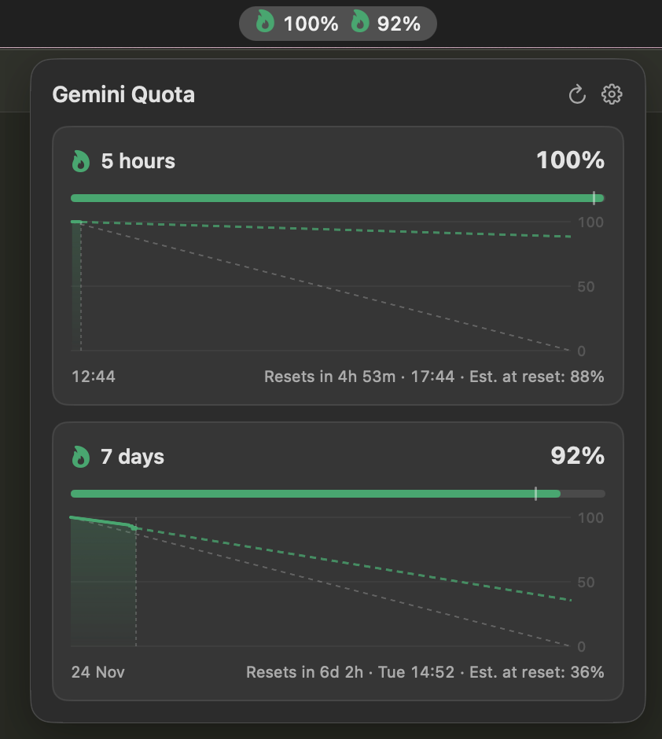

# antigravity-usage-menubar

Native macOS menu bar app for tracking and projecting your Google Antigravity **Gemini** 5-hour and weekly quota limits.



## Requirements

- macOS 14+ (Apple Silicon or Intel)
- Swift 6+ / Xcode Command Line Tools
- [Antigravity CLI (`agy`)](https://antigravity.google/product/antigravity-cli) installed and authenticated

## Build & Run

```bash
# Run unit tests
swift test

# Build the macOS .app bundle
./scripts/build-app.sh

# Launch the menu bar app
open dist/AgyUsageMenubar.app
```

To install permanently, copy `dist/AgyUsageMenubar.app` into `/Applications`.

## How It Fetches Quota

The app invokes `agy --settings ...` using the documented `statusLine` JSON hook (`antigravity.google/docs/cli/statusline`) inside a local PTY, reads the first `gemini-5h` and `gemini-weekly` quota snapshot (`remaining_fraction`, `reset_time`), discards all other fields, and terminates the process immediately without starting a conversation or spending quota.
